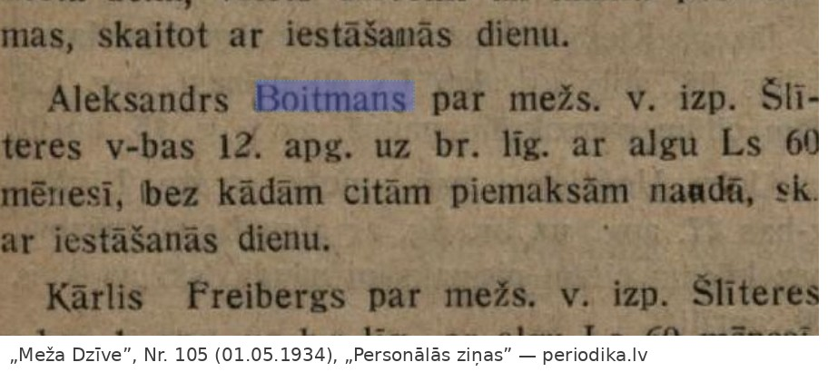

# Boitmaņi dokumentos

## HERITAGE7 dzimtas grāmatas paraugs

Trīs Puzes draudzē ierakstīti cilvēki ar līdzīgu vārdu. Viens Rīgas laulību ieraksts. Kurš no viņiem precējās ar Annetti Indriksoni?

Paraugā izmantoti desmit vēsturisku avotu ieraksti no 19. un 20. gadsimta. Atsauces ved uz arhīvu un bibliotēku lasītavām.

> Grāmatas uzdevums ir vienā vietā saglabāt stāstu un norādi uz to, kā katru faktu var pārbaudīt. Pētniecībai turpinoties, avotu identifikatori paliek nemainīgi.

### Saturs

| Lappuse | Nodaļa |
| --- | --- |
| 02 | Notikumu līnija un koka fragments |
| 03 | Trīs līdzīgi vārdi Puzes grāmatā |
| 04 | Kara un pārvietošanās laika meklējumi |
| 05 | Ko katrs avots pierāda |
| 06 | Avotu rādītājs |

<!-- page -->

# Notikumi un dzimtas koks

Puzes ierakstos redzamas trīs atšķirīgas vecāku kopas. Zemāk rādam atsevišķus koka fragmentus, jo saikne starp šiem zariem vēl ir jāatrod.

| Gads | Ko rāda avots | Avots |
| --- | --- | --- |
| 1847 | Fricis minēts Puzes miršanas reģistrā kā agrākais Blusu māju saimnieks. | S01 |
| 1867-1874 | Puzes dzimšanas ierakstos atšķirami trīs Ievalti vai Ēvaldi. | S02, S03, S04 |
| 1899-1901 | Rīgas laulības un Ventspils laulību saraksts dod divus izpētes pavedienus. | S05, S06 |
| 1934 | Maija un novembra preses ziņas dokumentē Aleksandra darba gaitas Šlīterē. | S09, S10 |

### Puzes dzimtas koka fragments

~~~tree
Andrejs + Līze | Ģirts + Marija | Uldriķis + Līze
Ievalts, 1867 [S02] | Ievalts, 1871 [S03] | Ēvalds, 1874 [S04]
Ewald Rīgā, 1899 [S05]
~~~

Nepārtrauktās līnijas rāda ierakstos nosauktos vecākus. Punktotā līnija rāda iespējamu identitātes sakritību starp 1867. gada Ievaltu un 1899. gada Ewaldu. Ieraksti saskan pēc dzimšanas gada un vietas. Papildu atšķirības pazīme vēl jāatrod.

<!-- page -->

# Trīs līdzīgi vārdi Puzes grāmatā

Rīgas Sv. Ģertrūdes draudzes 1899. gada laulības ierakstā ir Ewald Boitmann, 32 gadus vecs, dzimis Puzē 1867. gadā [S05]. Puzes grāmata piedāvā trīs cilvēkus ar līdzīgiem vārdiem. Salīdzinām dzimšanas gadu, vecākus un mājas.

| Ieraksts | Vecāki un vieta | Kā lietojam salīdzinājumā |
| --- | --- | --- |
| Ievalts, 1867 [S02] | Andrejs un Līze, saistīti ar Pedžu mājām. | Gads un draudze saskan ar Rīgas laulību. |
| Ievalts, 1871 [S03] | Ģirts un Marija, Blusu mājas. | Cits gads un cita vecāku kopa. |
| Ēvalds, 1874 [S04] | Uldriķis un Līze, Bēdras. | Cits gads un cita vecāku kopa. |

### No attēla līdz lasījumam

> S01 · Fricis Boitmans, 1847. gada miršanas ieraksts. LVVA 235/2/1729, attēls 0013, ieraksts Nr. 26. Latvisks kopsavilkums. Reģistrs Frici nosauc par agrāko Blusu māju saimnieku, dzimušu Ēčos. [Atvērt oriģināla attēlu Radurakstos](https://raduraksti.arhivi.lv/objects/1:4:11:2055:2461:22996#&gid=1&pid=13).

### Nākamais pārbaudāmais ieraksts

Ventspils 1901. gada laulību saraksts norāda uz pilno ierakstu Nr. 38 [S06]. Salīdzinot līgavaiņa vecumu, dzīvesvietu vai vecākus, varētu saprast, kuram no Ievaltiem pieder Ventspils ieraksts. Tas palīdzētu arī pārbaudīt Rīgas kandidātu.

<!-- page -->

# Kara laika avoti un izpētes robi

Pasu inventārs ir ceļvedis uz konkrētu arhīva lietu. Tajā redzams, kuru lietu pieprasīt. Dienesta gaitu un radniecību pārbauda pašos dokumentos.

| Avots | Iegūtais pavediens | Ko prasīt tālāk |
| --- | --- | --- |
| S07 · LVA 2416/1/2475 | Inventārā ir Artūrs Boitmanis no Rīgas. | Pieprasīt pases lietu. Pārbaudīt dzimšanas vietu un citus identifikatorus. |
| S08 · LVA 2416/1/2477 | Inventārā Ričarda Anša Boitmaņa dzimšanas vieta ir Puzes pagasts. | Salīdzināt pases lietas datus ar Puzes ierakstiem. |

### Ja parādās pavediens par pārvietošanos

Meklējuma virzienu nosaka notikums. Latvijas karavīru un trimdas lietām izmanto [LNA Diasporas krājumus](https://diaspora.arhivi.lv/?id=21). Par piespiedu darbu, vajāšanu vai pēckara pārvietotajām personām pārbaudi [Arolsen Archives katalogu](https://collections.arolsen-archives.org/en/search). Vācu militārajām lietām sākums ir [Bundesarchiv ceļvedis](https://www.bundesarchiv.de/im-archiv-recherchieren/archivgut-recherchieren/personen-und-familienforschung/personenbezogene-unterlagen-militaerischer-herkunft). Par kritušajiem vai pazudušajiem padomju karavīriem meklē [OBD Memorial](https://obd-memorial.ru/html/) un pārbaudi pirmavota attēlu.

### Arhīva pieprasījuma paraugs

Lūdzu norādīt, kā lasītavā apskatīt vai pasūtīt lietas LVA 2416/1/2477 kopiju. Pētījumam jānoskaidro, kuras dzimšanas un ģimenes ziņas atrodamas pašā lietā.

> Piemēra turpinājums. Reģistrā pieraksti iestādi, lietas numuru, ko tieši meklēji un rezultātu. Atsevišķi norādi, vai avotu izskatīji, atradi tikai kataloga ierakstu vai piekļuves dēļ vēl neizskatīji.

<!-- page -->

# Ko katrs avots pierāda

Vienai personai var būt vairāki vārda rakstības veidi. Katrai saiknei un notikumam ir savs apgalvojums. Vienam apgalvojumam var piesaistīt vairākas atsauces.

| Apgalvojums | Avots | Statuss | Ko vēl pārbaudīt |
| --- | --- | --- | --- |
| 1867. gada Ievalta vecāki ir Andrejs un Līze. | S02 | Dokumentēts | Saites ar vēlākajiem ierakstiem. |
| 1871. un 1874. gada ieraksti attiecas uz diviem atšķirīgiem cilvēkiem. | S03, S04 | Pamatojams | Vecāku vārdi, gadi un vietas atšķiras. |
| 1867. gada Ievalts varētu būt 1899. gada Ewald. | S02, S05 | Kandidāts | Meklēt sakritību vecākos, māju vārdā vai citā pazīmē. |
| Ričarda Anša dzimšanas vieta inventārā ir Puzes pagasts. | S08 | Kataloga ziņa | Pārbaudīt pases lietu. |
| Aleksandrs 1934. gadā strādāja Šlīterē. | S09, S10 | Dokumentēts presē | Iecelšanas un amata maiņas tekstos salīdzināt vietu, amatu un laiku. |

S09 · “Iecelti”, Meža Dzīve, Nr. 105, 01.05.1934. Attēls no [LNB Periodika](https://periodika.lndb.lv/periodika2-viewer/?lang=fr#panel:pa|issue:959005|article:DIVL185|query:Boitmans).

### Kā lasīt statusus

Dokumentēts nozīmē, ka informācija ir norādīta citētajā ierakstā. Pamatojamam secinājumam redzams salīdzinājums. Kandidātam vajadzīgs vēl viens avots vai atšķirības pazīme. Kataloga ziņu salīdzina ar pašu lietu.

<!-- page -->

# Avotu rādītājs

Atsaucēs norādīts arhīva fonds, apraksts, lieta un attēls vai ieraksts, kad tas ir pieejams. Tas ļauj avotu atrast arī tad, ja tīmekļa adrese mainās.

| ID | Avots un precīza norāde | Oficiālais avots |
| --- | --- | --- |
| S01 | Puzes miršanas reģistrs, LVVA 235/2/1729, 0013, Nr. 26. | [Raduraksti](https://raduraksti.arhivi.lv/objects/1:4:11:2055:2461:22996#&gid=1&pid=13) |
| S02 | Puzes dzimšanas reģistrs, LVVA 235/6/817, 0113, Nr. 96. | [Raduraksti](https://raduraksti.arhivi.lv/objects/1:4:11:2055:2461:23004#&gid=1&pid=113) |
| S03 | Puzes dzimšanas reģistrs, LVVA 235/6/817, 0143, Nr. 17. | [Raduraksti](https://raduraksti.arhivi.lv/objects/1:4:11:2055:2461:23004#&gid=1&pid=143) |
| S04 | Puzes dzimšanas reģistrs, LVVA 235/6/817, 0170, Nr. 27. | [Raduraksti](https://raduraksti.arhivi.lv/objects/1:4:11:2055:2461:23004#&gid=1&pid=170) |
| S05 | Rīgas Sv. Ģertrūdes draudzes laulību reģistrs, LVVA 1429/5/26, 0010, Nr. 14. | [Raduraksti](https://raduraksti.arhivi.lv/objects/1:4:11:2055:2470:23608#&gid=1&pid=10) |
| S06 | Ventspils lauku draudzes laulību saraksts, LVVA 235/14/549, 0056, Nr. 30. Atsauce uz Nr. 38. | [Raduraksti](https://raduraksti.arhivi.lv/objects/1:4:11:2055:2536:27027#&gid=1&pid=56) |
| S07 | Pasu lietu inventārs, LVA 2416/1/2475, PDF 55. lpp. | [LNA inventārs](https://www.archiv.org.lv/apraksti/F/LV_LVA_F2416_US1.pdf#page=55) |
| S08 | Pasu lietu inventārs, LVA 2416/1/2477, PDF 55. lpp. | [LNA inventārs](https://www.archiv.org.lv/apraksti/F/LV_LVA_F2416_US1.pdf#page=55) |
| S09 | Meža Dzīve, Nr. 105, 01.05.1934., “Iecelti”. | [LNB Periodika](https://periodika.lndb.lv/periodika2-viewer/?lang=fr#panel:pa|issue:959005|article:DIVL185|query:Boitmans) |
| S10 | Meža Dzīve, Nr. 111, 01.11.1934., “Pārskaitīti citā amatā”. | [LNB Periodika](https://periodika.lndb.lv/periodika2-viewer/?lang=fr#panel:pa|issue:923860|article:DIVL171) |

Avotu attēli apskatāmi attiecīgajās lasītavās. Dažiem vajadzīgs personīgs konts. Šajā grāmatas paraugā publicēti lasījumu kopsavilkumi un atsauces.

[Pētījuma piemērs Arete AIOS](https://areteaios.com/lv/my/heritage-demo) · [HERITAGE7 instrukcija](https://github.com/arete-aios/aios/blob/main/skills/heritage7/SKILL.md)
