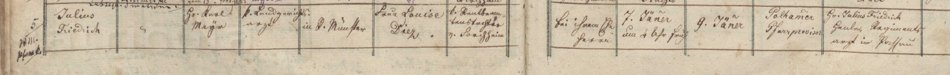
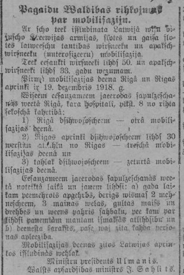
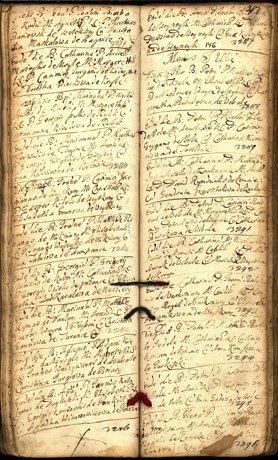
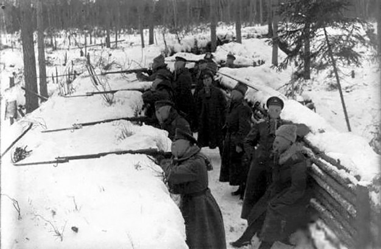
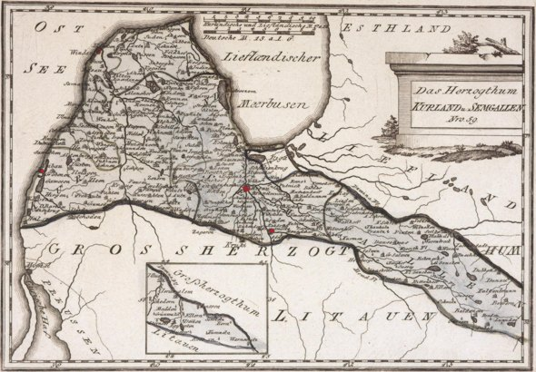

# Public archive examples

These images show how a record type changes what you can establish. They are examples of research methods from different collections. To establish a family link, compare identifying details across independent records.

| Parish registers | Military history |
| --- | --- |
|    **Rotthalmünster baptism entry, 1855.** Compare the date and name with the register columns. Rotthalmünster, Taufen 005 (1848–1884). Resized. [Original and public-domain terms](https://commons.wikimedia.org/wiki/File:Julius_Mayr_Kirchenbuch_Geburtseintrag.png). |    **Latvian mobilisation order, 1918.** It records where and when to report. Individual service needs a roster or personnel file. *Pagaidu Valdības Vēstnesis*, 23 December 1918, p. 1. LNB scan, cropped and resized. [Full issue](https://dom.lndb.lv/data/obj/file/763023.pdf#page=1). |
|    **Kamajai parish register, 17th–18th century.** Read the full page to understand the entry structure before enlarging a line. Rokiškio krašto muziejus, 11909 R-VIII-7759, image 149. Wikimedia Commons upload by Grybukas. Resized, [CC BY-SA 4.0](https://creativecommons.org/licenses/by-sa/4.0/). [Original and record](https://commons.wikimedia.org/wiki/File:Kamaj%C5%B3_RKB_1679-1704_krik%C5%A1to_ir_1681-1704_santuokos_metrik%C5%B3_knyga_149.jpg). |    **Latvian Riflemen, 1917.** The photograph illustrates the period. Use an attributable caption or roster to identify a person. Unknown photographer. Resized. [Original and public-domain terms](https://commons.wikimedia.org/wiki/File:Latvie%C5%A1u_str%C4%93lnieki_T%C4%ABre%C4%BCa_purv%C4%81.jpg). |

### Historical map

**Courland and Semigallia, 1791.** Compare historic spellings and districts before choosing a parish register. Franz Johann Joseph von Reilly. Resized. [Original and public-domain terms](https://commons.wikimedia.org/wiki/File:Map_of_Courland_in_1791_by_Reilly_059.jpg).

For a public example, use names only when the source concerns someone established to have died long ago. Use non-identifying or clearly fictional material otherwise. Confirm image reuse rights and cite every item.

[Return to HERITAGE7](../SKILL.md) · [Read the family-book example](family-book-sample.pdf) · [View the web gallery in Latvian](https://areteaios.com/lv/my/heritage-demo) · [View the web gallery in English](https://areteaios.com/my/heritage-demo)
